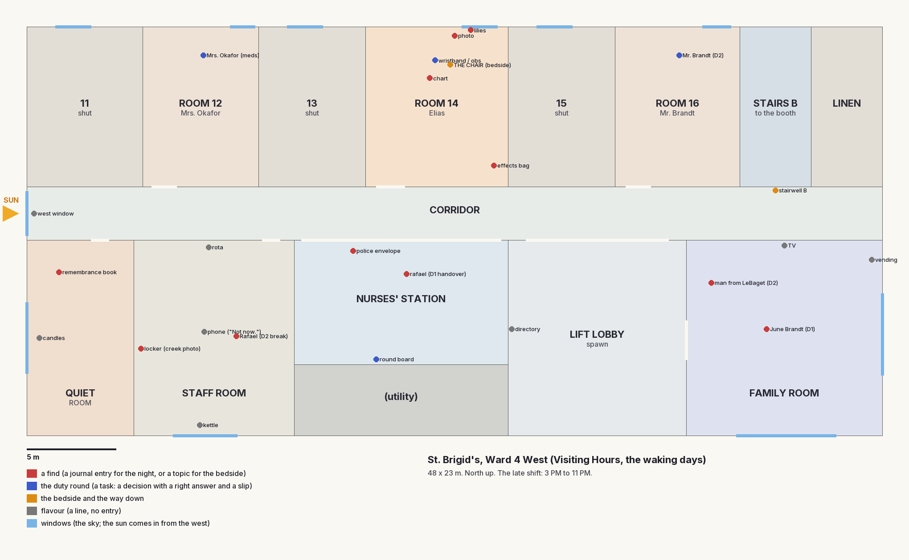

# The days, redesigned (Day agent, 2026-10-12)

The creator on the old days: *"a joke. The space is small, uninteresting to explore, and even interacting with everything
takes less than a minute ... There's no purpose to this interaction, it doesn't change anything in the story ... it's just
text, with nothing changing on screen."* This is the redesign and how it's built. The bar is REDESIGN.md section 3.

## 1. What a day is for

**The day is where Nadia prepares for the night.** It's her late shift on Ward 4 West (3 PM to 11 PM, the sun low in
the west). Every find gives the night something: a journal entry the night's battle can use as evidence, or a
**topic** she can bring to Elias's bedside. What she tells him at the bedside **changes the next night** (the dream hears
it). The duty round is the day's small gameplay: real nursing decisions with a right answer and a slip she catches,
and the slips wear her down (the Long Night's slope).

## 2. The floor (Ward 4 West, 48 x 23 m)



| Area | What's there | Why it earns its place |
|---|---|---|
| **Lift lobby** (spawn) | the lifts, the floor's directory, the WARD 4 WEST sign, a bench | arrival: the corridor and its sunlit end window are the first view (the landmark) |
| **Corridor** (48 m) | rooms 11 to 16, stairwell B, handrails, a noticeboard, a linen trolley, a wheelchair; **the tall west window** pouring the afternoon sun down it | the spine; the window is the vista ("you can see all of Larch Hill from here") |
| **Nurses' station** | the counter and Rafael (Day 1), the **round board** (Rafael's handwriting), the police envelope, monitors, the clock | the handover starts the round |
| **Room 14** | Elias: the bed, the live monitor, the drip, the chart, the photo, the lilies, the effects bag, **the chair** | the finds of the first day; the bedside |
| **Room 12** | Mrs. Okafor (Larch Street, number 9; "the boy who fixed my gate with a bicycle chain") | a round patient (meds on Day 1; obs and the penicillin catch on Day 2) |
| **Room 16** | Mr. Brandt (asleep on Day 1; awake on Day 2) | Day 2's band check; "too stubborn to die" |
| **Staff room** | Nadia's locker (**the creek photo**), the rota (seven lates in a row), her phone ("Not now."), the kettle, Rafael on his break (Day 2) | the creek topic; "Did Lena get out?" |
| **Quiet room** | candles, **the remembrance book** (Theo's team: "We kept your shirt. Number 4.") | Theo's topic |
| **Family room** | the muted TV ("ROUTE 9: SIX WEEKS ON, NO ARRESTS"), the vending machine, **June Brandt** knitting (Day 1), **the woman from LeBaget**, Corinne Vasseur (Day 2) | the patients topic; the visitor |
| **Stairwell B** | down to the booth at 11 PM (only after the round) | the exit |

## Round 2 (2026-10-13): the 3D cast, the chain on the hill, Look's light, Perf's list

Not yet seen in Unity (agents can't run it); compile checks and the dotnet suites are green on these files. (The code
landed in 8aa8139: a concurrent commit swept up the staged files under the House agent's message.)

**The cast** (People's `VhCharacter`, docs/redesign/people.md; `VhWardPeople.Cast`): **Mags** in the booth by the desk
(idle; she turns her head to Nadia within 5.5 m), **Rafael** behind the station's counter on Day 1 (idle) and in the
staff room's chair on Day 2 ("sit"), **the representative** (Corinne Vasseur) standing by the family room's door on Day
2, her fruit basket now on the chair beside her (the model's hands are empty), and **Elias** in bed (EliasBed, "lie").
When one of them speaks in the ink, their mouth moves for the line (`Say`), they play "talk" ("sit-talk" seated) and look
at her; they go still when the line or the dialogue ends. Off screen their skinning and animation stop
(`updateWhenOffscreen` off, `CullUpdateTransforms`). **Still stand-ins (no model yet):** Mrs. Okafor (room 12), Mr.
Brandt (room 16, both days), June Brandt (family room, Day 1), the man waiting in the family room (both days).

**Elias in bed** (`VhWardFloor.EliasModel`): the clip's pose is laid along the bed (feet-to-head turned towards the
headboard, his head on the pillow, his hips on the mattress), a blanket over his legs to the waist, the nasal cannula to
his face and the drip line to his far hand. His near hand (the chair's side, found from the pose) is driven by
`VhBedHand`: after the animation, its finger joints bend by a resting curl and `Twitch` flexes them twice (his fingers
move against hers); the bedside holds the back of that hand (`HoldPoint`), re-read when she sits. The monitor climbs and
settles as before. **What the model can't do:** open his eyes (painted shut, no lids), move his face (left still: he's
in a coma), or close his hand round hers (only the fingers flex). Without the prefab, the stand-in and its `VhHandRig`
hand lie there as before.

**The chain on the hill** (World's request): `Chain.Night2Scenes = { "DreamStreet", "DreamHouse" }`; `VhChainRunner`
sets `DreamStreetGame.NextNight` (1 for Night 1, 2 for Night 2, `Chain.NightOnTheHill`) before loading the hill, on the
dive and on the presenter's jumps. On Night 2 the gate loads DreamHouse (the street does it); the dive's card says
"Rowan Street". **Thrown out of Night 2** (`vh_n2_thrown_out`, now cleared by `Chain.Reset`): before the end card she
comes to in the booth's chair (`VhArea.chairEye`), Mags beside her, the house's lines play (`booth_thrown_out`) with
`DreamHouseLines.ThrownOutCosts` on screen; `Chain.ForceOut`'s cost is the runner's as before. **Lena's watch:**
`Chain.HasLenaWatch(save)` (the flag `vh_lena_watch`, the keepsake's journal entry, or Lena's battle ending with a
keepsake) puts People's `VhKeepsakeWatch` on Nadia's right wrist at the bedside (her code-built arm carries Mixamo-named
`RightForeArm` / `RightHand` transforms for it). In the normal order nothing earns it before Day 2 (Lena's battle is
Night 2); it shows from any later waking day, or when a test or the debug menu sets the flag.

**Look** (docs/redesign/look.md): the library builder makes Look's `ApplyHospitalDay` rig in a scratch scene (its sun
colour and intensity, bounce, `VhLookRig`, the `VH_HospitalDay` post volume; the ward's sun angle, 24 degrees up from
the west-south-west; shadows to 60 m) and saves it as `Ward/Generated/VH_WardLookRig.prefab`; the ward instantiates it
(volume priority 20), uses Look's sky (`Sky_EveningRoad01_2k`) and the sky's ambient at 0.55 (indoors). Without the
prefab, the ward's own sun and grade stand in. Surfaces: the walls are Look's `Plaster_Interior`, the ceiling its
`Ceiling_Tile`, the corridor, station and lobby floors its `Hospital_Terrazzo`; the ward's own textures (vinyl, fabrics,
metal, wood...) are set up the Look way (`VhLookLibrary.SetupLit`, its macro colour variation against flat or tiled
reads). The judges' indoor lessons: no untextured surface (every shell and prop surface is a textured PBR material; only
glows and screens are flat), no hard-edged decal (the ward has none; its pictures are framed prints), and **no
mismatched seams**: walls, floors and the ceiling take their UVs from the place's own frame (`VhMeshKit.PlaceUv`), so
the plaster and the floor run on across every joint between boxes.

**Perf's list** (docs/redesign/perf.md, Day): (1) shadowed lights: of the four that may cast shadows only the two nearest
her do (`VhWardRooms`; none on a tier without point-light shadows), and `VhPerfTiers.CapNow()` runs after the ward and the
booth are built; (2) parts under 15 cm cast no shadow (`VhMeshKit.Show`); (3) the floor is built a room a frame under the
day's black card (`VhWakingWard.HospitalSteps`, `VisitingHoursGame.EnterAreaStaged`), and the meshes static batching
replaced are freed; (4) per-room culling (`VhWardRooms`: each room's props, people and lights under its own root; from a
closed room only that room draws, from the corridor, station or lobby the rooms within 16 m); (5) the title: Nadia's
skinning only on screen, lights at intensity 0 off, the phone's and tablet's panels stop redrawing off camera
(`VhTitlePerf`); (6) the stand-in pictures compressed and non-readable (`VhTextures.Seal`); (7) reflection probes:
*JamKit > Visiting Hours > Bake the Ward Probes* (or `-executeMethod
JamKit.VisitingHours.EditorTools.VhWardLibraryBuilder.BakeProbesFromCommandLine`, needs a GPU) bakes the six probes into
`Ward/Generated/Probes` and the library; the ward uses them as custom probes. Until baked, realtime probes render once
with realtime probes switched on for the ward. Not done: the prompt-string cache (`PromptFor`) and the HUD's readable
textures (`Scripts/UI`, not this round's files).

**For the House agent:** `DreamHouseGame.Escape.cs` still plays `ThrownOutBooth` over black before `Chain.ForceOut`; with
the chain running, the booth now plays the same lines, so they're heard twice. Skip yours when `VhChainRunner` is up
(or keep only the costs card).

**Minutes:** Day 1 about 7 to 10 minutes played normally (the handover, a three-task round, about twelve finds, the
bedside); Day 2 about 6 to 9 (a five-task round, Rafael, Brandt, the visitor, the bedside).

## 3. The duty round (the gameplay)

The handover (Rafael, Day 1; the day's opening on Day 2) puts the **round sheet** on screen (top left; each task ticks
off as it's done). Each task is a decision in her hands, with one right answer and one or two tired shortcuts she catches
herself taking (a **slip**). Day 1's round is the tutorial, three tasks; Day 2's is five (the creator: "a bit shorter").

| Day | Task | The decision | The slip |
|---|---|---|---|
| 1 | Room 14: wristband against the chart | they match | "skip it, it's been checked twice" |
| 1 | Room 14: observations | chart them as they are | "copy last night's line" |
| 1 | Room 12: Mrs. Okafor's six o'clock | two 500 mg tablets with water | the 1 g infusion bag; codeine |
| 2 | Room 16: Mr. Brandt's band against his drug chart | the numbers don't match: hold his tablets, ring pharmacy | "close enough" |
| 2 | Room 12: Mrs. Okafor's obs (38.4, pulse 96) | call the doctor now | "recheck in an hour" |
| 2 | Room 12: her antibiotic | hold it: the red band, penicillin | give it, it's prescribed |
| 2 | Room 14: the drip | sodium chloride 0.9% | glucose 5% (same bag, same size) |
| 2 | Room 14: observations | chart them | "copy yesterday's line" |

**Consequences:** the round must be done before the bedside and the stairs. A slip is always caught (no one is hurt),
but it counts: Mags sees it in the booth ("your hands are shaking"), and three slips across the run are
one step down the Long Night's slope (`Chain.DespairTally`).

## 4. The bedside (shown, and consequential)

The chair by his bed, after the round. In first person: she sits (the view glides to the chair and lowers, turns to him;
the room softens behind his hand), **her hand comes into frame and takes his**, and she talks. She can tell him **two
things a day** (then "His heart's up. That's enough for one day."), or just sit. His body answers on screen: **his
fingers move against hers**, or **the monitor climbs** (the numbers and the beeping quicken), or, when she just sits,
**it settles**. When she's done, "E  Stand up": she lets go and rises.

What she can tell him depends on what she found. **What she tells him changes the next night:**

| Day | Topic | Opened by | His body | The night it changes (`DreamChanges` id) |
|---|---|---|---|---|
| 1 | Walt's shop | his effects bag (the keyring, Walt's card) | fingers | Night 1: **Walt's ledger lies open on his workbench** at the page of 41 identical lines (`n1_walt_ledger`) |
| 1 | The creek, and the bikes | the photo in her locker | heart | Night 1: **the old plank is back across the creek**, a short cut at the foot of the hill (`n1_creek_plank`) |
| 1 | His patients ask after him | June Brandt in the family room | heart | Night 1: **the hospital at the top of the hill has its windows lit** (`n1_hospital_lit`) |
| 1 | The phone | the police envelope | fingers | Night 2: **she's already said sorry out loud**: Lena's "He called you first" lands on an admission that's open from the start (`n2_lena_sorry`) |
| 1 | Just sit with him | always | calm | Night 1: **Walt greets her warmly, by name** (`n1_walt_warm`) |
| 2 | The lake, last summer | the photo on his locker (Day 1) | heart | Night 2: **the lake photo is up on the hall's photo wall**, lit, and counts as found (`n2_photo_wall`) |
| 2 | Theo's team | the remembrance book | fingers | Night 2: **Theo's room is open from the start**; Theo trusts her sooner (`n2_theo_room_open`) |
| 2 | Lena | Rafael: "Did Lena get out?" | heart | Night 2: **Lena is waiting at the window**; her anger starts a step higher (`n2_lena_wary`) |
| 2 | Just sit with him | always | calm | Night 2: **the house is gentle**; Lena's anger starts a step lower (`n2_lena_softer`) |

There's always more to tell than time to tell it (four topics for two places on Day 1, three on Day 2), so it's a
choice. What she told him is written in her journal ("I told him about Walt's shop... If he heard me, it'll be in there
tonight."), and Mags says what the monitor saw in the booth ("His heart did something this evening... Whatever you told
him, it's in there now. Watch for it.").

### The API the nights read (World and House agents)

In the core (`Packages/com.vibejam.jamkit/Runtime/Core/VisitingHours/`): `DayContent.cs` and `Chain.cs`.

```csharp
var save = GameRoot.Save.Data;
if (Chain.HasDreamChange(save, DreamChanges.WaltLedger)) { /* put the ledger out on the bench, open */ }
foreach (var id in Chain.DreamChangesFor(save, ChainSegment.Night2)) { /* every Night 2 change */ }
Chain.HasTold(save, "theo");        // the topic itself, if a line wants to know
DreamChanges.Find(id).what          // the change in words
```

Ask when the night builds. The ids are stable; an id a night doesn't know is ignored. A new game clears them
(`Chain.Reset`). The battles can also read the "told" journal entries (`told_<topic>`, in `Chain.Known`).

**Wired by me (data the game already reads):** the journal entries, the booth's reaction, the run's Despair and the
monitor's day-to-day state. **To wire in the nights (owners):** the street's ledger, plank, lit hospital and Walt's
greeting (World); the photo wall, Theo's room, Lena at the window (House); Lena's starting anger and the sorry admission
(Battle: `Chain.HasDreamChange(save, DreamChanges.LenaWary / LenaSofter / LenaSorry)`).

### Forced out of the dream (the House agent's hook)

```csharp
Chain.ForceOut("the house tipped her out");   // instead of Chain.Done() when a night throws her out
```

The night ends as with `Done`, and it costs: the forced exit is kept (`Chain.WasForcedOut`, `ForcedOutCount`,
`ForcedOutReason`); the next day opens on the crash call ("They called a crash on him at four this morning."), his
monitor runs higher (74 resting), Mags says "five nights, now. Not six." (`Chain.NightsLeft`); and each forced exit is
one step of Despair (`Chain.Strain` in `DespairTally`). The runner (`VhChainRunner.ForceOutNow` for tests) handles it.

## 5. The look

Every surface is a PBR material (URP/Lit: albedo, OpenGL normal map, a metallic/occlusion/smoothness mask) from CC0
ambientCG textures, tinted per surface (`VhWardLibrary`, built by *JamKit > Visiting Hours > Build the Ward Materials*
and by every *Rebuild Shell Scenes*; licences in `Templates/VisitingHours/Ward/LICENSES.md`). Signs, notices, the rota,
the round board, the TV, the remembrance book and the vending machine are printed/handwritten pictures (Inter and
Caveat, OFL). The windows show a CC0 HDRI sky (Poly Haven). The light (`VhWardLight`): a late-afternoon sun 24 degrees
up from the west-south-west, pouring down the corridor from the end window and through the south windows; cool
fluorescent panels; trilight ambient; six realtime box-projected reflection probes; ACES, bloom, warm white balance, a
light vignette; a shallow focus at the bedside. The booth at 11 PM gets the night version. Round 2: Look's hospital-day
rig replaces the ward's own sun, sky and grade when the library has it (see "Round 2"); the probes are baked.

**People** (`VhWardPeople`): since round 2 the People agent's 3D cast (`VhCharacter.Spawn` of Mags, Rafael,
Representative, EliasBed; `VhWardPeople.ModelFor`), posed by animation state (standing "idle", sitting "sit", Elias
"lie"); the people without a model are stand-ins in their clothes (PBR fabric and skin). See "Round 2" above.

## 6. The lines

Every line of the days is in `Assets/JamKit/Templates/VisitingHours/Dialogue/VisitingHours.ink`. The creator's Mags
scene (STORY-PROSE 83-92) is kept word for word; everything else on the days is mine, in the voice of their lines
(short, dry, tired, proud; Mags brisk and warm). Rafael: the handover, Day 2's "Did Lena get out?". Mrs. Okafor, June
and Harold Brandt, the man from LeBaget (Daniel Arce, "Community Partnerships", "Has he said anything?", no transfer
clock). The round's decisions and slips. The nine bedside topics. Mags's booth reactions. **Round 2:** the man from
LeBaget is now a woman (the creator's call): **Corinne Vasseur**, Community Partnerships (speaker "The woman from
LeBaget"), still asking "Has he said anything?", still no transfer clock; the journal's entry follows ("The woman from
LeBaget"). The booth's `booth_thrown_out` is the House agent's `DreamHouseLines.ThrownOutBooth`, word for word.

## 7. Captures for the judge (main runs them)

Recordings are **player flags only**: never a windowed editor (one took focus from the creator, 2026-10-12).

- **Stills:** `VisitingHours.exe -ward-shot "<folder>" -screen-width 1920 -screen-height 1080 -screen-fullscreen 0`:
  18 framed stills of every area on both days and the booth (UI hidden),
  9 bedside frames (sitting, her hand coming in, the topics, his fingers, the second topic, his heart on the monitor,
  "E  Stand up", rising, standing), then one still per examinable on each day. `shots.txt` lists them.
- **A recorded day:** `VisitingHours.exe -day-run "<folder>" [-day-run-day 2] -screen-width 1920 -screen-height 1080
  -screen-fullscreen 0`: the autopilot plays the whole day at real speed on the real controller (walking the ward,
  every find, the round, the bedside, the stairs, the booth to the dive), a JPG frame every 0.5 s and `run.txt`.

## 8. Built in

`Scripts/World/VhWakingWard.cs` (the kit, the booth), `Scripts/World/VhWardFloor.cs` (the floor, built in steps),
`Scripts/World/VhWardRooms.cs` (per-room culling, the shadow budget), `Scripts/Waking/` (`VhWardLibrary`, `VhWardLight`,
`VhWardPeople`, `VhHandRig`, `VhBedHand`, `VhPatientMonitor`, `VhBedside`), `Scripts/Opening/VhTitlePerf.cs`,
`Editor/VhWardLibraryBuilder.cs` (the materials, Look's rig prefab, the probe bake),
`Scripts/VisitingHoursGame.Day.cs` (the round, the bedside, the ink's `vh_state` and `vh_topic`), `Scripts/Chain/`
(`VhWardShot`, `VhDayRun`, `VhChainRunner`: forced out, sound hand-offs), the core's `DayContent.cs` and `Chain.cs`, and
the shell's title sound fix (`GameRoot`: the ambience and a battle's restored music no longer carry into the title).
