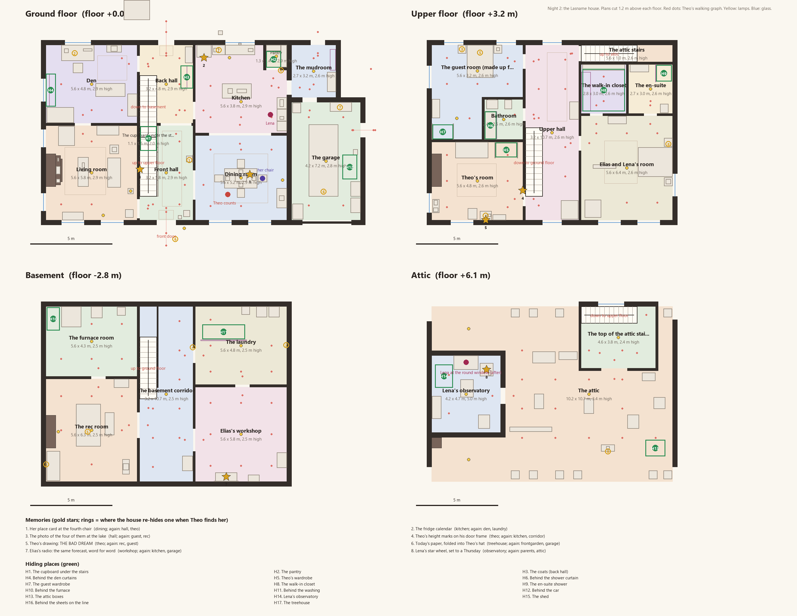
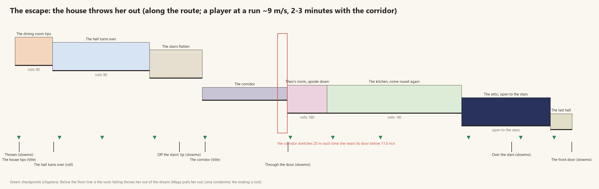

# Night 2, redesigned: the house, hide-and-seek and the escape

House agent, 2026-10-12. Answers the creator's rejection of Night 2 (`docs/REDESIGN.md`): the broken geometry, the few
small rooms, being found costing nothing, the half-baked escape (phasing, the corridor that never stretched, walls that
don't run, falling costing nothing). Everything below is built and tested in dotnet; **none of it has been seen in Unity
yet** (see "Not verified" at the end).

`house-plan-floors.png` (the four storeys, cut 1.2 m above each floor), `house-plan-site.png` (the lot) and
`house-escape-route.png` (the escape along its route) are drawn from the code itself:
`dotnet run -c Release --project tools/house-plan -- plan.json` then
`uv run --with pillow python tools/art/vh_house_plan.py plan.json docs/redesign`.

## Round 2 (2026-10-13): after the first judging

The first render was judged a FAIL (`docs/redesign/judge/house-1.md`: lighting 4, materials 3, art direction 3, level
design 4, physical integrity 2, scale 6), and the recorded hide-and-seek stalled at the front-hall stairs. What changed,
defect by defect. **None of it has been seen in Unity yet** (no agent can run it); the dotnet suites are green.

| Defect (house-1.md, the recorded run) | What was done |
|---|---|
| **Models lying on their sides** (chairs, coffee table, armchair, Theo's chair and desk, the den TV, the jar, the yard chair and fire pit) | `HouseFurnishing.Fit` overwrote the FBX root's rotation. Single-mesh Poly Haven models carry Blender's -90° axis conversion on that root, so they lay down. Fit now puts each model under a holder and keeps the import's own transform. Per-model fit specs live in `house-assets.json` `fit` / `kenney_fit` (`rotate`, `yaw`, `stretch`, `dims_m`). Kenney's kit faces -z (measured from the FBX geometry) and is turned round. Each axis may stretch up to 12 %, so beds and sofas fill their boxes. |
| **The lint only checked the plan's boxes** | **The mesh lint** (below): what was actually drawn, checked by bounds. It runs in every rebuild and fails loudly. |
| **Memory glows: hard spheres cutting through solids** | Each memory is a readable lit thing, facing where she stands to take it: the calendar on the fridge door (card, magnet, rings), the framed lake photo, THE BAD DREAM pinned to the wall over Theo's desk (it lay flat on top of his bookcase), the folded place card, the height marks on the casing, the star wheel on its easel, the paper hat, the radio. Each glows with `JamKit/House/MemoryGlow`, a soft camera-facing disc pulled toward the camera and faded against the scene's depth (no hard edge), and has a small warm light. The umbrella's halo uses the same shader. |
| **Sconces / eyeball pendants** | The "sconces" were the memory glows (fixed above). The "eyeballs" were the pendant model lying on its side (fixed by Fit). |
| **Stairs: treads past the stringer; the recorded run's z-fighting "slab", the dark band, the stall** | Thin treads with nosings and risers on the slope line, a closed stringer each side, and the soffit 6 cm under the line; no two faces shared. The ramp stays the hidden collider. The dark band at head height was each lamp's shade casting its bulb's shadow; fixtures cast none now. The stall had three causes: the lake photo was out of the autopilot's reach (measured from her feet); coming down, she met the slab's edge at head height and mantled into the balustrade; Theo's map had points over the stairwell. Stairwells are longer, the attic stairs' door is a full-height arch, and Theo no longer replans on a flight. The under-stair panelling is a sloped painted spandrel. **New test:** every flight and the treehouse ladder walked up and down at a walk and a sprint. |
| **Treehouse: an adult staircase** | It is drawn as a ladder: two rails running on past the deck as handholds, open slats. The collider is still a 45° ramp. |
| **23 built-in-place primitives** | Replaced. `HouseProps` builds real-reading furniture where no model fits, using `HouseShapes` (rounded boxes, lathes, tubes, cloth) in clean enamel, chrome, brass, painted and natural wood, and fabric. The list: the counters (panelled doors, handles, a recessed plinth, worktop overhang), the sink (sunk steel basin, gooseneck tap), the fridge (rounded enamel, chrome handles, the calendar), the basin, vanity and bath (taps), the beds (frames, mattresses, puffed duvets, pillows, throws), the telescope (a brass refractor on a wooden tripod, aimed up through the round window), washer and dryer, furnace, water heater, freezer, crib, ping-pong table, pegboard, umbrella stand, window seat, pancakes, and bookcases with books as books. Cloth: curtains on a rod, the shower curtain, coats on hooks, and the sheets and washing pegged on lines that now exist. Balustrades have balusters; the trampoline has a padded rim, springs and legs; the oak is Look's whole oak. From Poly Haven (CC0, 1k, `tools/house/ph-fetch.py`): the stove, the porch's wall lantern, a desk lamp, bulb sockets, the workshop pendant, a wicker basket, a book set, cushions, a plant, a clock, a watering can, a hose. Kenney's leftovers (toilet, lamps, coat stand, toaster, desk chair) are in clean colours, not plaster noise. |
| **Lighting: blown hotspots, murky rooms, peach void sky** | Room lights are spots pointing down from a visible fixture (a glass dome, a pendant, a bare bulb on its socket), so the ceilings aren't blasted. Table lamps, Lena's reading lamp and the basement bulbs are new. Outside is Look's golden-hour rig and HDRI sky (the camera cleared to solid peach before). Inside, the interior grade is a local volume round the house. The fork's stand-in hill, Rowan and Chapel Row and Look's backdrop ring close the lot. The escape's attic has a night-sky dome. |
| **Oxblood everywhere** | Each room has its own finish: sage stripe in the living room, blue paper over white panelling in the dining room, green in the den, dove grey in their room, Theo's stars, a trellis in the guest room. The creator's oxblood stripe stays in the halls. The wallpaper now tiles: DreamArt imported it Clamped, which made one 0.5 m tile with smeared edges (also the escape's "seam"). |
| **No line-of-sight breakers** | A linen press halfway along the upper hall's 10 m run; a dressing screen and an armchair in their room; a free-standing bookcase in the rec room; in the attic, two runs of shelving across it, the old wardrobe, suitcases and a rolled rug. Theo's map, the reach tests and the round still pass. |
| **Scale** | Their bed is 1.8 x 2.1 with a 1.1 m headboard (beds' boxes now hold their headboards). The attic is broken into bays. The treehouse is a ladder. |
| **The round window looking at the roof** | It looked onto the roof's underside because it sat below the roof line. Raised to 2.35-3.95 m above the attic floor, drawn round: the corners filled, a round reveal, ring frames, a disc of glass with a cross of glazing bars. |
| **Chapel Row empty; no Lena at the window** | The escape fork built Chapel Row as a street (`HouseEscapeChapelRow`): the wall and railing, wet pavements, kerbs, a road with a crossing, 13 lamps, houses, a lane up the hill, the stand-in hill under the house, Look's backdrop. Lena stands on a dais in the round window, lit (`lenaWindow`). |
| **The escape: one recoloured corridor box** | Escape fork (`HouseEscapeBuilder`, `HouseEscapeDressing`, `HouseEscapeKit`, `HouseEscapeLook`; runtime `EscapeRoomTip`, `EscapeSwing`, `EscapeDoubleDoor`). Each room is furnished as the room it was, with the house's own props placed by its roll, and its own paper. Each tips 40° into its roll as she reaches it, then settles; pendants swing. The corridor repeats a brass threshold, a side door, the same photo and a sconce pair every bay, ending in the lit red double door (sidelights, fanlight, lantern, light under it). The dado is one sloped piece: no steps, no seams. The attic has a starry night with a Milky Way, the family's things drifting. The last hall's open door shows warm light, not the void. |
| **Captions** | Rewritten to match the shots. seek-01 says the counting pose isn't drawn (Theo stands beside his chair now, not in it). seek-02 hides Lena. seek-04 looks into the workshop. Shot 13 looks at the drawing over the desk. The escape captions say what each room now is. |
| **Recorded runs opened a windowed editor** | `-house-record` in the built player (`HouseRecordFlag`, like `-day-run`); `tools/house-capture.ps1` launches it minimized. |
| **Perf** (perf.md, House) | `HouseLightBudget` gives realtime shadows only to the two nearest "(main)" room lights; every other light, the memories and the escape included, is shadowless. Small things cast no shadow (`VhPerfShadows.Rules.Indoor`) and cull with distance (`VhPerfLod.CullSmall` on the furniture). Structure, furniture and outside details are `MarkStatic` for batching and the occlusion bake; the escape's rolling rooms are not. Reflection probes are Baked (the realtime ones never rendered). The HUD makes no per-frame strings or layout. |

### The mesh lint

`HouseMeshLint` (core, `Runtime/Core/DreamEscape/HouseMeshLint.cs`, tested in `HouseMeshLintTests`) checks what the
builder drew, by bounds, against the plan's solids and each other.
- **What's recorded.** Every `MeshBuilder` box and smooth shape is recorded with its part and its kind:
  - Owned: built furniture, stairs;
  - Mounted: trims, casings, fixtures, outside details;
  - Model: fitted models, their real bounds in the house's frame;
  - Free: the cut-outs;
  - Hanging: pendants and the memories' things.
- **The rules.**
  - Nothing goes more than 2 cm into a solid that isn't its own (3.5 cm for trims and casings).
  - Built things stay inside their part.
  - Models, cut-outs and memories rest on a floor or surface, or touch the wall or ceiling they hang from.
  - Each fitted model's height-to-width ratio matches its real one (Poly Haven's dimensions) within 35 %, or it's
    "sideways".
  - Each model is drawn at 0.55-1.8 of its real size, or it's "scale".
  - Models and free things don't go into each other.
  - Each mesh of a several-mesh model touches the rest of it (the den TV's floating box).
  - At plan level, every furniture, cupboard, picture, rug, cloth and rail part rests on or touches a solid. The sheets
    and the washing used to hang from nothing; now they have lines.
- **Where it shows.** The rebuild logs every issue as an error (`JAMKIT_HOUSE_MESHLINT [kind] ...`), then
  `JAMKIT_HOUSE_MESHLINT 0 issues in N drawn things (M models)` or `FAIL: n issues`. With issues,
  `RebuildFromCommandLine` **exits 3** (the scene is still saved, so the captures can show it).
- **Its result so far.** It has never run in Unity, so it is unknown. In dotnet, the plan-level rules pass on the real
  plan, and the synthetic cases catch sideways, floating, overlapping and outside.

### For Battle: the cards Night 2 gives

| Card id | What | Made by |
|---|---|---|
| `mem_fourth_chair` | Her place card at the fourth chair | sitting at the table |
| `mem_calendar` | The fridge calendar: "Pancakes!" on Sundays, a key on Thursdays | finding it |
| `fact_photo` | The photo of the four of them at the lake | finding it |
| `mem_height_marks` | Theo's height marks, stopping at ten | finding it |
| `mem_bad_dream` | THE BAD DREAM: Elias in surgeon's scrubs leaving, Theo and Lena at the table (redrawn, not a monster) | finding it |
| `ded_same_saturday` | Elias's radio: the same forecast, word for word (memory id `mem_radio_loop`) | finding the radio |
| **`mem_lena_thursdays`** | **New.** Lena's star wheel, set to a Thursday (Lena's Thursdays) | finding it |
| `ded_saturday_off` | The calendar plus today's paper (the paper hat in the treehouse, or Night 1's Saturday paper) | holding both |

The paper hat is half of `ded_saturday_off`, not a card itself. The ids are `DreamHouseStory.Mem*` /
`HideAndSeekRound`'s card list (test `TheMemoriesBecomeTheBattlesCards`).

### What House needs from World

1. **An API that builds the real middle band (Chapel Row to School Lane) into a given root at HillAnchors.** The
   DreamHouse scene could then use the real hill instead of the stand-in (`HouseEscapeChapelRow`). Until then, keep
   `EscapeExit` (24, 15, 153), the 7 m terraces and Chapel Row running east-west.
2. **The house's outside changed shape slightly:**
   - the round window moved up the tower's north wall (2.35-3.95 m over the attic floor);
   - the porch light is a wall lantern;
   - the attic stair's opening is full height.

   The body's footprint and heights are unchanged (HouseMax* still holds).
3. **The first-person body.** World owns the first-person body. If its head or hair ever shows in the camera (the dark
   translucent band was the lamp shades, not the body), the house can't fix that.

## 1. The house

A real family house, in its own frame (front door at the origin, facing the street at -z), placed on the hill at World's
`HillAnchors.HouseOrigin` (24, 9.6, 122), yaw 0. 31 rooms, 678 m2 indoors, 522 parts, every one with a collider.

| Storey | Floor | Rooms |
|---|---|---|
| Basement | -2.8 m | the rec room (ping-pong, the old couch), the furnace room, the basement corridor, Elias's workshop (his bench, his radio), the laundry |
| Ground | 0 | the front hall (the stairs, the photo wall), the living room (the fire, the window seat), the dining room (the table set for four), the kitchen, the pantry, the den (Elias's desk), the back hall (the coats, the basement stairs), the cupboard under the stairs; the mudroom and the garage (the car under its cover) |
| Upper | 3.2 m | the upper hall, Theo's room (his desk, THE BAD DREAM pinned over his desk, the height marks on his door frame), the bathroom, the guest room made up for her, Elias and Lena's room with its walk-in closet and en-suite, the attic stairs |
| Attic | 6.1 m | the attic (the family's stored life, the dormer), the top of the attic stairs, Lena's observatory in the tower (the telescope at the round window) |
| Outside | | the front garden and path, the back yard (the oak and Theo's treehouse, the sheets on the line, the trampoline, the shed), Rowan Street |

**Why a treehouse:** it earns its place as the hide-and-seek's farthest hiding place and where today's paper is, folded
into Theo's hat (the memory that ties Night 1's Saturday to this one).

**How it's built** (`Runtime/Core/DreamEscape/DreamHouse*.cs`, engine-free): a kit of walls with openings, slabs with
holes, stairs (steps, each a collider), furniture boxes and props, all as oriented boxes. `HouseLint` checks every pair
for overlap (separating axis); the only allowances are stair ends into floors (<= 0.4 m), ramps against walls
(<= 0.12 m), roof slabs meeting (<= 0.45 m) and the chimney through the roof. **The lint finds 0 overlaps**, checked in
dotnet (`DreamHouseTests`), by `tools/house-plan` (exit code 2 on any) and logged on every rebuild (`JAMKIT_HOUSE_LINT`).
`DreamHouse.WalkClear` and the walking-graph tests prove every room and every hiding place is reachable on foot.

**What it looks like** (`Dream/Editor/House/`; round 2 changed much of this, see above): Look's golden-hour rig with the interior grade as a local volume,
Look's materials and metre UVs; 50 Poly Haven CC0 models (sofas, beds, tables, chairs, the fridge, lamps, shelves...)
fitted into their boxes (`Dream/House/house-assets.json`, `LICENSES.md`) and 16 CC0 surfaces (floorboards, tiles,
plaster, brick, carpet); built where no free model fit (the wardrobes, the washer and dryer, the telescope, the
umbrella stand, the treehouse, the oak via `VhLookTrees`). The wallpaper is the creator's oxblood stripe. 35 lamps, each
room lit as a room (`HouseFurnishing.Lamps`, with reflection probes). Lena and Theo are the cast's cut-outs through
People's `DreamCutoutView` (REDESIGN 7: only Nadia and Elias are 3D in the dream).

**Collision:** every solid part has a box collider on a layer she collides with (the old glass went through her: it was
on Ignore Raycast; now it blocks). **67 walls run** (every wall longer than 1.5 m, marked `MovementSurface.runnable`, the
player's `onlyMarkedWalls`).

## 2. Hide-and-seek (5-8 minutes)

**The rules** (`HideAndSeekRound`):
- She sits at the fourth chair: her place card is the first memory (1 of 8 on the counter, top of the screen, with three
  red pips for the catches).
- Theo counts at the table, face in his arms: 20 s, then 15 s, then 12 s after each catch. He peeks once, like a kid
  ("I wasn't peeking! ...Much.") and remembers which floor he saw her go to.
- She finds the memories (look at one and press Interact). Each becomes an evidence card for the argument.
- **Getting found costs:** the house takes back the last memory she found and hides it again in one of its other places
  (the one farthest from where she was caught, its unused places first). Theo counts again where he found her, and he
  gets quicker: faster walk, more hiding places checked, quicker to see. Mags says what it costs.
- **The third catch ends the round** with whatever she holds ("...You win.").
- **Every memory found:** Nadia's line (the creator's, word for word, with its two endings by the Despair route), and
  Theo comes straight for her; his finding her ends the round.
- Then his question, the creator's: **"Is Dad going to be sad?"** (Yes / No, I promise / say nothing; kept in the save,
  `vh_theo_dad_sad`; his reply and his parting line follow the answer).
- Theo's room is "the base" until she's found three memories (unless she told Elias about Theo's team).

**Theo** (`TheoBrain`, engine-free, multi-floor): searches room by room the way a ten-year-old would: rooms he hasn't
tried yet first, the floor he glimpsed her on, the room a noise came from, his favourites. In each room he looks round
and checks some of the hiding places (opening cupboards, pulling back curtains), not all. He **hears** her (running,
landing, sliding, a wall run; through walls less, through floors at 35 %) and goes to look ("I heard that!"). He
**sees** with the stealth kit's sight and meter (eyes at 1.2 m; crouching, the dark and cloth slow it): the eye at the top
right fills while he sees her, full is "found you". **Peeking** (hold LB / RB, Q / F) leans her head round a door
frame: he sees only that head (a sliver: his meter crawls, about 9 s of steady sight against 2 s stepped out), and his
first count teaches it ("[LB / RB]  Hold to peek round corners"; docs/STEALTH.md "Peeking"). He calls into rooms, giggles, hums, says "Not here..." (lines in
`DreamHouseLines`). He walks a 234-point graph; stairs are links. No allocation per tick.

**17 hiding places:** the cupboard under the stairs, the pantry, the coats in the back hall, behind the den curtains,
Theo's wardrobe, behind the shower curtain, the guest wardrobe, the walk-in closet, the en-suite shower, behind the
furnace, behind the washing, behind the car, the attic boxes, Lena's observatory, the shed, behind the sheets on the line,
the treehouse.

**The memories and their cards** (each in its first place, then the two places the house re-hides it):

| # | Memory | Where | Re-hidden in | Card |
|---|---|---|---|---|
| 1 | Her place card at the fourth chair | dining room | hall, Theo's room | `mem_fourth_chair` |
| 2 | The fridge calendar ("Pancakes!" on Sundays, a key on Thursdays) | kitchen | den, laundry | `mem_calendar`; with the Saturday paper (found tonight or carried from Night 1) it becomes `ded_saturday_off` |
| 3 | The photo of the four of them at the lake | front hall | guest room, rec room | `fact_photo` |
| 4 | Theo's height marks, stopping at ten | Theo's door frame | kitchen, basement corridor | `mem_height_marks` |
| 5 | THE BAD DREAM (Elias in scrubs walking out of the door; Theo and Lena at the table) | pinned over Theo's desk | rec room, guest room | `mem_bad_dream` |
| 6 | Today's paper, folded into Theo's hat | the treehouse | front garden, garage | half of `ded_saturday_off` (not a card itself) |
| 7 | Elias's radio: the same forecast, word for word | the workshop | kitchen, garage | `ded_same_saturday` |
| 8 | Lena's star wheel, set to a Thursday | the observatory | their room, the attic | `mem_lena_thursdays` |

**For Battle:** `mem_lena_thursdays` is a new card (Lena's Thursdays); `mem_bad_dream` now means the redrawn picture
(Elias in surgeon's scrubs leaving, not a monster).

**What she told Elias at his bedside (Day 2) changes the house** (`DreamChanges`, wired): "the lake" puts the photo on
the hall wall already, found; "Theo's team" opens Theo's room from the start; "Lena" has her waiting at the window,
colder; "just sit" makes her gentler and gives Nadia 5 s more each count.

**How long:** the dotnet round (`TheWholeRoundPlaysOut`) uses a sprinting bot that knows where every memory is and
ignores stealth. Round 1 had it caught three times in 111-202 s. It was mostly standing under memories it couldn't
reach. Now that every memory is in reach and Theo no longer turns back on the stairs, it takes all 8 in 46-67 s, caught
0-1 times. A player who has to find the memories, crouches, hides and reads the lines should take the 5-8 minutes asked
for. **That's an estimate, not measured.** If the recorded run finds it too easy, tune Theo's `LevelSpeed`,
`LevelFill`, the count or the memories' places.

## 3. The argument

As before: Elias never comes down ("His plate's still there. Cold."), she questions Lena with the cards she holds (the
Battle agent's real-time battle via `DreamHouseGame.StartBattle`, id `lena_night2`). Unsure or Condemns sets the escape.

## 4. The escape (2-3 minutes)

The house throws her out: a fever-dream run through rooms that can't fit in the house, unexpectedly long for how small
it looks (562 m of route). Built upright far below the house (local (0, -260, 400): the hill must leave that space
empty). The house folds shut behind her (a rubber-banded pursuer that only catches someone who stalls).

| Room | Route (m) | What happens |
|---|---|---|
| The dining room tips | 0-38 | the table slides, the room rolls 90 degrees: the walls are the floor ("The walls are the floor--") |
| The hall turns over | 38-136 | the hall rolls under her as she runs it (a framed camera roll), the photo wall underfoot |
| The stairs flatten | 136-189 | the stairs flatten into a slide; off its lip in slow motion |
| The corridor | 189-275 | **the corridor that gets longer as she nears its end** (below) |
| Theo's room, upside down | 275-315 | his glow stars under her feet |
| The kitchen, come round again | 315-451 | rolled -90: the kitchen again, bigger |
| The attic, open to the stars | 451-540 | no roof: the night sky (Lena's stars), over a gap in slow motion |
| The last hall | 540-562 | the front door the right way up; her umbrella by it |

**The corridor** (`StretchCorridor`): the creator's beat, now real. Its last two bays are the same; when she reaches
10 m from the door slower than 11 m/s, the game moves her (and the fold) back one 20 m bay under a dolly zoom: the door
has pulled away. The first approach always stretches (the reveal: "It's... longer."). Fast enough (a slide into it, a
wall kick, slide hops down its 4 % slope) and the door bursts open ("Got you."). Each stretch lets the fold 2.5 m nearer.
Lena unsure: after three stretches Theo holds the door ("In here! It's a shortcut, I promise!"). Lena condemning: it wants
11.5 m/s and the fold gains 4 m a stretch. Mags coaches it line by line.

**Cinematic:** title cards ("The house tips", "The corridor"), slow motion at the four lips (0.3-0.4x), the hall's
framed roll, the corridor's dolly zoom, a held look back at the window (`HouseCameraFx`), and each room's light, fog and
sound faded in as she enters it; the movement camera's own speed lean and FOV underneath.

**Timing:** the dotnet autopilot runs it in 61-63 s at 20-300 fps with two stretches, never falling. A player at a run,
stretching more and losing speed in the rolls, should take 2-3 minutes (an estimate). Sprinting alone never opens the
corridor: the house closes on her (`HouseEscapeTests`).

**Out onto the hill:** through the last hall's front door she comes out of the dream's door onto Chapel Row
(`HillAnchors.EscapeExit` (24, 15, 153), the hill's middle band) in the rain. The umbrella works as in Night 1
(`docs/DREAM-ESCAPE.md`). A beat out of the door, a held look back: **Lena in the tower's round window**, watching her
go. At the end of the rain path, Night 2 ends (`DreamHouseGame.Escaped`; standing alone, a new visit).

## 5. Falling costs: thrown out of the dream

Falling (below the escape's floor, or off Chapel Row) or the fold catching her **throws her out**:
- slow motion, the camera rolls, Mags: "Nadia-- I've got you. I'm pulling you out.";
- black, then the booth (`DreamHouseLines.ThrownOutBooth`: "His heart went through the roof when you fell. I had to.
  That's a night we don't get back. And they'll remember how you left.") and the card "Thrown out of the dream. Despair
  +1. Lena's mind is made up against you. Night 2's ending is lost.";
- **the costs:** Lena's outcome hardens to Condemns (`vh_lena_condemns`, `Chain.SetLenaOutcome("Condemns")`), the flag
  `vh_n2_thrown_out`, no umbrella, no Lena at the window; the chain ends the night with `Chain.ForceOut(reason)` (Day's
  cost: Despair a step, the crash call the next day, one fewer of Mags's nights). There are no checkpoints back.

## 6. The lines

Every line is written, in `DreamHouseLines` (`Packages/com.vibejam.jamkit/Runtime/Core/DreamEscape/DreamHouseStory.cs`):
the street, the door, the hall breathing, pancakes, Theo's count, peeks, calls into each room, hearing, losing her,
giggles, "found you" (three), the catch's cost (Mags), each memory's thought, the creator's all-found line and its two
endings (kept word for word), Theo's question (the creator's) with the three answers and replies, Elias not coming down,
Lena unsure / condemning, Theo's parting by her answer, the house tipping, each escape room, the corridor's stretches,
breaking through, Theo's door, the umbrella, Lena at the window, thrown out (the fall, the booth, the costs), and the
bedside variants. No placeholders. Day's booth can play `ThrownOutBooth` when `vh_n2_thrown_out` is set.

## 7. Where things are

- Core (dotnet-tested): `Runtime/Core/DreamEscape/` `DreamHouse.cs` (types and kit), `DreamHousePlan.cs` (the plan),
  `DreamHouseFurnish.cs` (furniture, spots, memories, Theo's nodes, lamps), `HouseLint.cs` (the plan's boxes),
  `HouseMeshLint.cs` (what was drawn), `HideAndSeekRound.cs`, `TheoBrain.cs`, `HouseWalker.cs` (the autopilot's legs),
  `HouseEscape.cs`, `DreamHouseStory.cs` (phases and lines).
- Unity: `Dream/Scripts/House/` (`DreamHouseGame` and its partials `.HideAndSeek`, `.Escape`, `.Drive` (chapters,
  autopilot, recorder); `TheoView`, `HouseMemoryView`, `HouseHud`, `HouseCameraFx`, `HouseLightBudget`,
  `HouseRecordFlag`, the escape's `EscapeRoomTip`, `EscapeSwing`, `EscapeDoubleDoor`); `Dream/Editor/House/`
  (`DreamHouseBuilder`, `HouseGeometry`, `HouseFurnishing`, `HouseProps`, `HouseShapes`, `HouseMaterials`,
  `HouseMeshes` (`MeshBuilder`), `HouseMeshLintRun`, the escape's `HouseEscapeBuilder`, `HouseEscapeDressing`,
  `HouseEscapeKit`, `HouseEscapeLook`, `HouseEscapeChapelRow`, `DreamHouseExterior` (World calls `Build(Transform)` to
  put the house on the hill), `DreamHouseCapture`).
- Assets: `Dream/House/` (Poly Haven models and surfaces, CC0; `house-assets.json` with the per-model `fit` specs,
  `LICENSES.md`), `Dream/House/Shaders/HouseMemoryGlow.shader`, `Dream/House/Escape/` (the night sky shader, the
  papers; `tools/art/vh_escape_textures.py` makes them).
- Tools: `tools/house/ph-fetch.py` (Poly Haven models at 1k into the manifest), `tools/house-plan`,
  `tools/art/vh_house_plan.py`, `tools/house-capture.ps1`.
- Tests: `core-tests/DreamEscape` (`DreamHouseTests`, `HouseEscapeTests`, `HouseMeshLintTests`, `HousePeekTests`),
  EditMode `DreamHouseEditorTests`, PlayMode `DreamHousePlayTests`.

## 8. Captures

`tools/house-capture.ps1` (through the memory cap; `-Rebuild` rebuilds the scene first and goes on to capture when the
mesh lint exits 3):
- **stills** (`DreamHouseCapture.StillsFromCommandLine`, batch mode with graphics, no window), 1920x1080 at her eye
  height (1.5 m), into `out/house-captures/<time>/` with `shots.txt`: 25 of the house, 4 hide-and-seek moments, each
  escape room from its start plus the corridor's last bays and the umbrella's door, and Chapel Row (the street in the
  rain; Lena in the round window);
- **recorded runs in the built player** (`HouseRecordFlag`): `VisitingHours.exe -house-record "<abs>/out/house-runs/<time>"
  -house-record-run all|hideandseek|escape -screen-width 1920 -screen-height 1080 -screen-fullscreen 0 -logFile
  "<abs>/out/house-runs/<time>/player.log"`. It goes to the house through the presenter, plays the night on the
  autopilot (the hide-and-seek, on through the argument, the escape), writes a JPG every 0.5 s of game time into
  `hide-and-seek/` and `escape/` with `run.txt`, and quits (`JAMKIT_HOUSE_RUN_OK`; `JAMKIT_HOUSE_RUN_FAIL` and exit 1 if
  the house never came up). The script runs it minimized from `Builds/Play/VisitingHours/VisitingHours.exe` (`-Exe` to
  change). The editor's `-houseRecord` (play mode in a window) still works but isn't used.
`tools/dream-capture.ps1` shoots the same house stills and then the dream escape's.

## 9. Unity steps (main; one GPU job at a time, through the memory cap)

1. **Rebuild and stills** (the rebuild imports the new models and scripts first; GPU for the stills):
   `powershell -NoProfile -ExecutionPolicy Bypass -File tools/house-capture.ps1 -Rebuild -Only stills`.
   - Read `out/house-rebuild.log` for `JAMKIT_HOUSE_LINT 0 overlaps`, the `JAMKIT_HOUSE_MESHLINT` lines and
     `JAMKIT_HOUSE_OK`. Exit 3 means the mesh lint found issues; the script captures anyway.
   - The stills go to `out/house-captures/<time>/` with `shots.txt`.
   - Batch rebuild alone:
     `Unity.exe -batchmode -projectPath . -executeMethod JamKit.DreamEscape.EditorTools.DreamHouseBuilder.RebuildFromCommandLine -logFile out/house-rebuild.log`.
2. **Optional bake** (GPU, minutes):
   - `Unity.exe -batchmode -projectPath . -executeMethod JamKit.Look.EditorTools.VhLook.BakeFromCommandLine -vhScene Assets/JamKit/Templates/VisitingHours/Dream/Scenes/DreamHouse.unity -logFile out/house-bake.log`
     bakes the reflection probes and APV.
   - Then the occlusion bake, CPU:
     `Unity.exe -batchmode -nographics -projectPath . -executeMethod JamKit.Perf.EditorTools.VhPerfOcclusion.BakeFromCommandLine -perfScene Assets/JamKit/Templates/VisitingHours/Dream/Scenes/DreamHouse.unity -logFile out/perf/occlusion-house.log`.
   - A later rebuild drops both: bake again after it.
3. **The player:**
   - Build it with `powershell -File tools/play-builds.ps1 -Templates VisitingHours -RestoreTo VisitingHours`. DreamHouse
     must be in its scenes.
   - Then record: `powershell -NoProfile -ExecutionPolicy Bypass -File tools/house-capture.ps1 -Only runs` (`-Run hideandseek|escape`
     for one), into `out/house-runs/<time>/` (`hide-and-seek/`, `escape/`, `run.txt`, `player.log`). No editor window
     opens; the player runs minimized and quits by itself.
4. **Commit what Unity made** after the first import and rebuild:
   - the `.meta` files: `HouseProps.cs`, `HouseShapes.cs`, `HouseLightBudget.cs`, `HouseRecordFlag.cs`, the 12 new
     model folders under `Dream/House/Models/`;
   - the materials under `Dream/Materials/House/` and `Dream/House/Escape/Materials/`;
   - `Dream/Generated/House/` and `Dream/House/Escape/StandIn/HillStandIn_Terrain.asset`;
   - Look's tinted variants (`VhLookLibrary.Tinted`: the wet street, the papers' plaster variants);
   - the rebuilt `DreamHouse.unity`.

## Not verified

None of this has been opened in Unity. Round 1's first render found real problems, and round 2 is still blind. Most
likely to need a look:
- the mesh lint's first real result;
- the Kenney yaw turn, and the new models' fit;
- the spot lights' levels (blind numbers);
- the interior volume's blend at the doors;
- the round window's winding;
- the memory glow shader on the GPU (it passed `tools/look/shader-check.py`);
- the escape's tipping in play;
- the player flag in a build;
- frame time.

The lint, the reach, the stairs, the round and the escape's timings are dotnet's.
