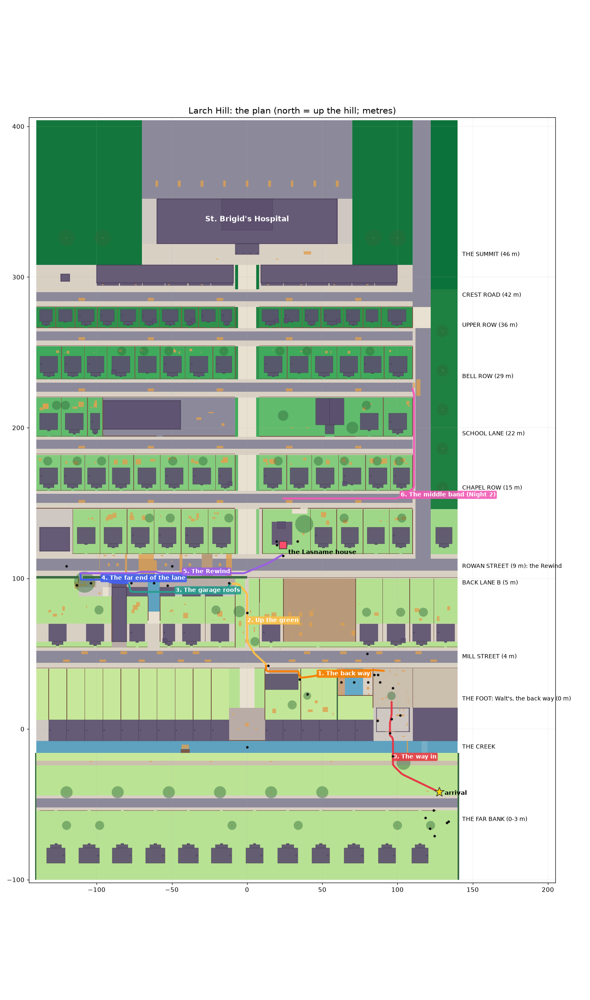

# World: Larch Hill, one hill for Nights 1-3 (the World agent's level design)

Status (2026-10-13): **round 2: the hill is rebuilt to fit the memory cap; still not seen in Unity.** Milestone 1 couldn't
be built (the build died at 6.8 GB, the capture at 4.6 GB): round 2 builds it a band at a time without graphics, with far
less geometry, shared props and trees, levels of detail and a memory report in the log ("Memory and frame time" below).
It also takes the Look library (trees, grass, the terrain ring, the soundscape), the House agent's house (and leaves its
escape's space empty), Elias in 3D at his grill and Lena's watch on Nadia's wrist. It compiles and every dotnet suite
passes; whether it fits under the cap is for the first build's report to say. Nothing here is "good" until a judge has
seen the captures.

`world-plan.png` is drawn from the core data (`dotnet test core-tests/DeepBlock/DeepBlock.Tests.csproj --filter
"Name=ExportThePlan"`, then `uv run --with matplotlib python tools/art/hill-plan.py <json> docs/redesign/world-plan.png`).
North (up the hill) is up; the coloured lines are Night 1's legs (0-5) and Night 2's middle-band line (6).

## The idea

The creator's notes: the old hill was three trivial routes, no granular progression, the house at the top, no hospital,
and Night 2 abandoned the hill for a flat plain. They asked for one hill for Nights 1-3, proper progression, the house low
on it ("the house is the tutorial for the movement and stealth"), and their Dunwall-distillery note: a dense space whose
safe traversal is the interest, balanced around our move set.

So Larch Hill is a **hillside of terraces climbed in switchbacks**. Each band is a contour street with a wall above it;
the critical path runs along a band one way through its back yards, lanes and roofs, then climbs to the next band and
comes back the other way. You always see the next step (the next wall, roof or tree) and the far goals: **the Lasname
house** (low on the hill, Night 1's goal) and **St. Brigid's Hospital** crowning the summit (the landmark from everywhere,
Night 3's goal). The gold beacon is gone.

## The bands (Y is the ground; X east, Z north)

| Band | Height | What's there | Nights |
|---|---|---|---|
| The far bank | 0-3 | The arrival on a rise; Creek Lane South; the Lindqvists' front garden (the loop: sprinkler, dog, ball, "Lovely Saturday for it!") | 1 |
| The creek | bed -4.6 | 8 m wide in a 4.6 m stone channel, water 1.2 m deep; the old footbridge out since the flood; the ford steps downstream | 1 |
| The foot | 0 | **Walt's bike shop** (apron, half-open garage door, counter with Saturday's paper, workbench with the ledger, the patched bike), **Walt's yard** (Walt on his low wall), the creek-side terrace, the Foot Square (the Route 9 terminus), the Mill Steps; **the back way**: the Pruitts' (the pool), the Okafors' (a lawn of kids' things), the Hendersons' (the raised garden, the old stable, the slot) | 1 |
| Mill Street | 4 | A contour street over the foot (a 4 m wall and a tall fence); Row B's houses; **Larch Green** (a pocket park: the view up to the house); the allotments (kept low so the arrival sees the house over them) | 1 |
| Back Lane B | 5 | The lane behind Row B west of the green: lock-up garages (the roof line), the **ditch**, Mr. Bell's workshop, **the Old Mill** and its arch with the **shutter on the loop's timer**, the loading bay, the scaffold, **the old oak** (and its treehouse) | 1 |
| Rowan Street | 9 | The house's street; a tall hedge along its edge over the lane. **The block party** (gazebos, bales, a removal truck by a dug-up trench, a bouncy castle, a car and a skip, a trench across the street, a stage); **the Lasname house** (`HillAnchors.HouseOrigin`), its gate, Eli's barbecue in the side garden, the big maple | 1 (the Rewind), 2 (the start) |
| The middle band | 15 / 22 / 29 / 36 | Four terrace streets (Chapel Row, School Lane, Bell Row, Upper Row) with retaining walls between them, house rows, **the Larch Steps** (the spine straight up the hill), **St. Anne's** (bell tower and spire), **Larch Hill Primary** and its playground, **Hill Road** (the Route 9 bus line up the east side, flat at each terrace, steep between; the bus waits at Bell Row) | 2 (the escape), 3 |
| The top | 42-46 | **Crest Road's shops** (bakery, diner, florist, pharmacy, laundromat, news, hardware: awnings, signs, lit interiors, flats over), the forecourt, **St. Brigid's Hospital** (main block, tower with the sign and the helipad, entrance canopy, ambulance bay); its interior comes with Night 3 | 3 |

## Night 1, beat by beat (the critical path)

The dotnet autopilot's times are a skilled run; a first-time player takes 5-10 times longer with the lines, the looking
and the failures. Total path ~480 m; the night runs about **14-18 minutes plus Walt's argument**.

| Time (first play) | Beat | Taught / tested | In view | Rest / vista |
|---|---|---|---|---|
| 0:00-0:45 | **The arrival** on the far bank's rise. Mags: "You're in... He's up that hill somewhere." The Lindqvists' loop behind her (heard twice: `mem_neighbours_loop`). | - | Walt's shop across the creek, the house above its roof, St. Brigid's on top | **Vista**: the whole hill |
| 0:45-1:15 | **The creek** (8 m) | **Double jump** (Mags teaches). Fail: into the water; wading is slow (no double jump or wall-run, 2.6 m/s); out by the ford steps downstream, back up the bank: ~20 s | Walt's apron, the shop's half-open door | |
| 1:15-1:40 | **Walt's garage door** (1.15 m gap) | **Slide** (Mags teaches) | The paper on the counter, the bench, the patched bike | Inside the shop: a quiet room |
| 1:40-2:20 | **The shop**: Saturday's paper (`mem_saturday_paper`: with the loop, `ded_same_saturday`); the patched bike; Walt's ledger (optional: out only when the bedside's "Walt's shop" topic put it there) | - | | |
| 2:20-~7:00 | **Walt's yard**: "Mr. Abernathy. Sitting on his wall" (`mem_walt_alive` + Day 1's card: `ded_walt_dead`); his argument (the battle agent's `walt_night1`) | The argument tutorial (Mags coaches) | | |
| 7:00-7:30 | **Walt gets up**: "Over the wall, the way you kids always went." | **Mantle** (Walt teaches: his 1.6 m low wall) | The Pruitts' pool against Mill Street's wall | |
| 7:30-8:30 | **The Pruitts' pool** (12 m, against a 4 m wall) | **Wall-run** (Mags teaches). Fail: into the pool; steps at the shallow end, back to the patio (~6 s) | The pergola beam | |
| 8:30-9:00 | **The fallen pergola** (1.15 m beam) | **Slide** again, straight off the wall-run (the first combination) | | |
| 9:00-9:40 | **The Hendersons' wall** (2.4-2.9 m over the Okafors' lawn) | **Jump and grab** (jump, then mantle) | The old stable and the slot | |
| 9:40-10:40 | **The slot** behind the stable (3.5 m wide, 4.55 m up to the street) | **Wall-jump** (Mags teaches: "Kick off one into the other"). Fail: back to the slot's floor, retry | Mill Street above | |
| 10:40-11:30 | **Mill Street**: Mr. Okonkwo washing his car, kids on bikes, the allotments. Mags: "There's the house... that's St. Brigid's on top." | - | **The house** over the green, the hospital | **Rest + vista** (back down over the foot to the creek) |
| 11:30-12:00 | **Up Larch Green** to the lane | - | The house, closer | Rest |
| 12:00-13:30 | **The garage roofs**: crates up, a 3 m gap, a 5 m gap, the **ditch** (8 m: double jump) | **Test 1**: jump, double jump, mantle in a chain. Fail: down into the lane (walk on and climb back at the crates in each gap) or into the ditch (4.4 m deep: out by its steps at the far end, round through the Bells' garden: ~20 s) | The workshop, the Old Mill | |
| 13:30-14:00 | **The Old Mill's shutter** (up 5 s, down for 7, on the loop's 12 s clock) | **Timing**: slide under it as it comes down, or wait for it | | |
| 14:00-14:40 | **The loading bay** (8.4 m, along Rowan Street's wall) then **the scaffold's bar** then **the old oak** | **Test 2: wall-run, then slide, then mantle, mantle, mantle** in one line | Eli at his barbecue, far up Rowan Street | Optional: up round the trunk to **the treehouse** ("NADS + ELI", `mem_treehouse`); the lane's **nail** (`mem_the_nail`) for walkers |
| 14:40-16:00 | **Rowan Street: the Rewind.** "Eli!" He heard; so did the dream. A wall of gold light sweeps east down the street: whatever it touches goes back to the start of the day. Through the block party: the gazebo's curtain, the bales, along the truck over the trench, the skip, the trench across the street, the stage, to the gate | **The set piece**: everything chained, against the clock. Caught: a white rewind back to the street's end; the party snaps back; each catch slows the next wave (7.2 m/s, then 6.8, 6.4... never under 5.6) | The house, the whole way | |
| 16:00-17:00 | **The gate**: Eli at the stove through the window, Theo setting the table; he looks up; Lena steps between them and takes him in; the door; the porch light; Mags: "His heart rate's up. That's enough for tonight. You found the house." | - | | The night's last image |

**Failure always costs something and is never a free mid-air reset**: water (slow wading and the way out), a fall from a
roof or wall (the band below: walk round and climb back), the Rewind (back to the street's end). Out of the world only
happens through a bug: then she's put back at the start of the band she was on.

**Optional lines and rewards** (they feed Night 2's battle; the battle agent wires them):
- `mem_walt_ledger`: Walt's ledger, 41 identical lines "Sat. E., rear tyre, flat. Patched." (when the bedside's "Walt's
  shop" put it out).
- `mem_the_nail`: in Back Lane B outside Mr. Bell's workshop, for those who walk the lane: "A roofing nail, point up, in
  the same crack. His tyre never stood a chance." With the ledger: the flat tyre every Saturday (L3c).
- `mem_treehouse`: the treehouse at the top of the old oak (the harder climb round the trunk): "NADS + ELI. NO GIRLS."
  He crossed the last bit out for her: the dream still keeps her name (against "you're the intruder").
- Skilled lines: the roof line over the lane (faster than the lane), a slide-boosted double jump over the pool, the
  truck's roof in the Rewind, the garage roofs straight to Rowan Street west of the oak.

**The bedside changes the night** (docs/redesign/day.md, read through `Chain.HasDreamChange`):
- "Walt's shop": the ledger lies open on his bench (otherwise it's put away);
- "the creek": the old plank is back across the creek (a walk instead of the double jump, X 106);
- "his patients": St. Brigid's windows are lit;
- "just sit": Walt greets her warmly, by name.

**Saturday on the loop**: the Lindqvists' sprinkler, dog and ball and the line (`NeighbourLoop`, the same every time;
Night 2 replays it); Mr. Okonkwo's car wash, the Fairbanks' mower, the Ruizes' yard sale, two kids on bikes riding Mill
Street, the old man in the allotments, the block party (dancers, a grill, the lemonade stall), barbecue smoke over the
party and Eli's grill, the shutter's clock, the Route 9 bus waiting. Each is a `HillPersonSpot` (role, activity, a loop
path): **billboards** (docs/REDESIGN.md section 7: only Nadia and Elias are 3D in the dream) through the People agent's
`DreamCutoutView` (lit paper since People's round); **Eli at his grill is the People agent's 3D `Elias` prefab**
(`Resources/People/Elias`, idle; he turns and walks in when she calls him), a cut-out only if the prefab isn't built.

## Nights 2 and 3 on the hill

- **Night 2** starts on Rowan Street outside the house (`HillAnchors.Night2Start`, `DreamStreetGame.night = 2`): the loop
  replays exactly ("Morning, Nadia! Lovely Saturday for it!"), the party is there, no Rewind; reaching the gate fires
  `DreamStreetGame.Night2AtTheDoor` for the House agent's night, and with nobody listening the game loads the House
  agent's scene itself (`DreamStreetGame.night2HouseScene`, "DreamHouse"). **To start Night 2 on the hill** whoever loads
  DreamStreet for Night 2 sets `DreamStreetGame.NextNight = 2` first (used once). For main/Day (not World's files): the
  chain's `Chain.Night2Scenes` is `{ "DreamHouse" }`; make it `{ "DreamStreet", "DreamHouse" }` and set `NextNight = 2` in
  `VhChainRunner.StartNight` before the load, and Night 2 starts on the hill and walks into the house. The escape bursts out of the house onto **Chapel Row**
  (`HillAnchors.EscapeExit`) and its line runs up the middle band to the **Route 9 stop on Hill Road** at Bell Row
  (`HillAnchors.EscapeEnd`): the Chapel Steps behind the Lasnames', the terrace walls (6-7 m between terraces: wall-jumps
  and the steps), the rooftops of the rows, St. Anne's buttresses and roofs, the school's playground and flat roof, Hill
  Road. Milestone 1 blocks the band out and gives a simple line (`LarchHill.escapeLine`); the escape's run is the House
  agent's and its middle-band challenges are World's next milestone.
- **Night 3** starts on the summit: Crest Road's shops (walkable awnings, flat roofs), the forecourt, the hospital's
  entrance (`HillAnchors.HospitalEntrance`); the interior comes with Night 3.

## Anchors (for the House agent and anyone placing things on the hill)

The numbers live in code: `Packages/com.vibejam.jamkit/Runtime/Core/DeepBlock/HillAnchors.cs` (namespace
`JamKit.DeepBlock`, a static class, usable from core, the Dream scripts and the editor). World axes: X east, Z north (up
the hill), Y up; the creek's north bank is Y 0.

| Anchor | Where | What |
|---|---|---|
| `HouseOrigin` | (24, 9.6, 122), root yaw 0 | The Lasname house's root: the front door's threshold. The house's own frame is `DreamHouseExterior`'s (front faces local -Z), so on the hill its front faces **south, down the hill, onto Rowan Street**. |
| `LotX0..LotZ1` | X 10-42, Z 116-146 | The Lasnames' lot: front garden, side garden (the barbecue, east), back garden. The hill puts nothing inside it but fences, gates and ground. |
| `HouseMax*` | X 14-36, Z 122-142, up to Y 31.6 | The most the house's body may take. The round 5 exterior fills X 16.4-30, Z 122-137.4. |
| `FrontGate` | (24, 9, 116.3) | The front garden's gate on Rowan Street. Night 1 ends here. |
| `BackDoor`, `BackGate` | (24, 9.6, 137.4), (29, 9.6, 144) | The back door (movable along the back wall) and the foot of the Chapel Steps, which climb east along the middle band's first wall (X 30-40) to Chapel Row. |
| `Night2Start` | (8, 9, 110), yaw 60 | Night 2 starts on Rowan Street outside the house, the loop replaying. |
| `EscapeExit` | (24, 15, 153), yaw 0 | Where Night 2's escape bursts out into the middle band: Chapel Row (the first terrace above the house). |
| `EscapeEnd` | (110, 29.15, 226) | The end of the middle band's escape line: the Route 9 bus stop on Hill Road (Bell Row's level). |
| `Night1Arrival` | (128, 3, -42), yaw -28 | The rise on the creek's far bank: Walt's shop across the water, the house above its roof, the hospital on top. |
| `HospitalEntrance` | (0, 46, 322), yaw 180 | St. Brigid's main doors on the summit (Night 3). |

Band heights: the foot 0, Mill Street 4 (Back Lane B 5), Rowan Street 9, the middle band's terraces 15 / 22 / 29 / 36,
Crest Road 42, the summit 46.

### The house on the hill, and where House stops and the street begins (round 2)

- **In the hill scene** the house is the House agent's own: `DreamHouseExterior.Build(Transform)` (called by name; a kit
  house of the same footprint stands in only if it's missing). When it's there, the hill removes the core's stand-in box
  colliders for the house (style `lasname_house`): the house's own colliders are the house. World's own front wall and
  the room behind the window are gone (they overlapped the house). What World adds to it: the family's cut-outs in the
  front room (Theo, Elias, Lena, seen through the front window at the night's end), **the house's own open front door put
  on a hinge** at its right jamb (house-local (0.625, 0, 0.17); open = 90 degrees, shut = 0: the night shuts it), the porch
  light beside House's lantern, and Perf's rules on its lamps (2 shadowed at most) and small parts (no shadows).
- **The boundary.** House owns everything of the house itself, and the escape. World owns the ground everywhere, the lot's
  fences and gates, Rowan Street, the Chapel Steps and **Chapel Row** (a real terrace street at Y 15 with its two rows of
  houses at Z 158-182 and Hill Road at its east end; `EscapeExit` (24, 15, 153) is on its paving), the neighbours and
  everything further out. House builds only what the escape needs at its exit (the dream's door Nadia bursts out of, the
  rain) and nothing else on Chapel Row.
- **In the House agent's own scene** (DreamHouse), the judge's round 1 found the lot ending in a cut dirt edge over a void
  and Chapel Row an empty plane: House's stand-ins. World's answer is a call: **`DreamStreetBuilder.BuildSurroundings(root,
  radius = 140)`** (`JamKit.DreamEscape.EditorTools`, call it by name as World calls `DreamHouseExterior.Build`) draws the
  real hill round the house in the house's own frame (the hill shifted by -`HouseOrigin`): every chunk within the radius
  (ground, retaining walls, steps, Rowan Street, Chapel Row and its rows, the neighbours' houses, props, the Look library's
  trees and grass) with their colliders, and the terrain ring round everything; only the house's stand-in is left out.
  Its meshes go to `Dream/Street/Generated/HouseSurroundings/` (rebuilt each call). House should then drop its own lot,
  street and Chapel Row stand-ins.
- **The escape's space** (house-local (0, -260, 400), world about (24, -250, 522)) stays empty on the hill: nothing of the
  hill or the terrain ring goes below Y -12 there (the ring never dips more than 10 m under its centre's level).

## How the hill is made

- **Core data** (`Packages/com.vibejam.jamkit/Runtime/Core/DeepBlock/`): `LarchHill.cs` (helpers, the switches, the
  Rewind's numbers), `LarchHill.Foot.cs`, `.Lower.cs`, `.Upper.cs` (the layout), `.Night.cs` (spots, routes with the
  autopilot's cues, the 25 camera views, the bands), `HillWorld.cs` (houses, trees, props, buildings as data, and
  `HillColliders`, which makes their colliders: what you see is what you stand on), `HillAnchors.cs`, `LarchStreetStory.cs`
  (the night's state and every line). Ground tiles never overlap and cover the whole hill; a tile's sides that stand above
  its neighbours are drawn as retaining walls or kerbs.
- **The drawing** (`Assets/JamKit/Templates/VisitingHours/Dream/Editor/Street/`): `DreamStreetBuilder.cs` (the scene),
  `DreamHillDrawing.cs` (ground, steps, retaining walls with copings, kerbs, cracks, stains, leaves, manholes and drains,
  road markings, the party's things, wires, bunting; the grass is the Look library's tufts), `DreamHillStreaming.cs`
  (round 2: the band-by-band build, shared props, the Look library's trees and terrain ring, the house's surroundings for
  House), `HillLods.cs` (each chunk's levels of detail), `HillBuildReport.cs` (the memory and size report), and the kit in
  `Kit/`: `HillMesh` (a mesh sink: bevelled boxes, tubes, cards, world-metre UVs, one renderer per material per 40 m
  chunk, or one multi-material mesh for a shared kit piece; writes compact 36-byte vertices directly), `HillMeshStore`
  (one asset per chunk, saved and unloaded band by band), `HillMat`/`HillMaterials` (every material id, its CC0 texture pack, tint and tiling; URP Lit/Unlit only; a Look
  material at `Look/Materials/Hill/<id>.mat` overrides one), `HillAtlas` (the generated atlases' cells), and the drawings
  `HillHouses`, `HillTrees`, `HillFences`, `HillProps`, `HillLandmarks` (`HillKitPreview` builds a preview scene of them).
  Every wall runs (`onlyMarkedWalls` off); slopes are convex wedge colliders.
- **Textures** (`Dream/Street/Textures/`, licences in its `LICENSES.md`): 25 CC0 packs from Poly Haven and ambientCG
  (colour, OpenGL normal, AO), and generated packs from `tools/art/hill-textures.py` (window interiors, shop and ward
  interiors, signs in the repo's OFL fonts, awnings, leaf clusters, grass and flower cards, ivy, decals).
- **Light** is the Look agent's: `VhLook.ApplyGoldenHour` (sun at bearing 250, 10 degrees up), `VhLook.SetupCamera`,
  reflection probes per street; the far scenery is named "(backdrop)" for their bake.

## Memory and frame time (round 2)

The bar (docs/REDESIGN.md sections 3 and 9): the hill builds, opens and captures within the session cap (30% of RAM,
4.6 GB), and plays at 120 fps at 1080p on the RTX 3050 (60 fps floor).

**Why milestone 1 couldn't be built.** The build died at 6.8 GB committed (the 45% cap), allocating vertex data, after the
asset database's own memory had run out ("Not enough space [12]" is ENOMEM). Unity's own allocators held only ~0.7 GB then
(default 276 MB, graphics 394 MB), so ~6 GB was outside them. The build ran **with graphics (DirectX 12)**, made every
mesh twice over (built at 48 bytes a vertex, then re-laid by `VhPerfMesh.Compact` with eight managed copies of its
arrays), wrote 3,876-4,997 separate asset files (an asset refresh each) and held all of it until the scene was saved.
The likeliest culprit is the D3D12 upload memory of thousands of meshes in a batch editor that never presents a frame;
the managed heap's churn is the second. Neither is certain until a real run reports: hence the report.

**What round 2 changes.**
- **Builds without graphics** (`tools/street-capture.ps1 -Build` runs the build with `-nographics`; the capture still
  renders, with `-D3D11` as a fallback).
- **Band by band** (`DreamHillStreaming.cs`): two chunk rows (80 m) at a time are drawn, built, given LODs and shadow
  rules, saved as **one asset per chunk** (its meshes as sub-assets), marked not readable, unloaded, and the heap
  collected (`GC.Collect`, `EditorUtility.UnloadUnusedAssetsImmediate`) before the next band. Whatever falls outside the
  band goes to a sink that keeps nothing (`HillMesh.Discarding`).
- **Compact meshes made once**: `HillMesh` writes position float3, normal and tangent half4 and uv float2 (36 bytes)
  straight into the vertex buffer, with 16-bit indices under 65,536 vertices and its own tangents: no readable 48-byte
  copy, no re-layout.
- **Far less geometry.** Milestone 1's 5.32M vertices were 77% chamfers on small boxes: copings 1.23M, window trim 0.94M,
  fences 0.78M, props' metal 0.58M, kerbs 0.27M (counted from the play checkout's generated hill). Round 2: a chamfer under
  1.5 cm, or on anything thinner than 10 cm, is drawn sharp (24 vertices, not 96: `HillMesh.MinBevel`,
  `MinBevelThickness`); copings and kerb edges run on as one piece up to 24 m instead of a bevelled stone every 2 m.
- **Shared meshes.** Props: one mesh per kind, variant and size (388 props, a few dozen meshes), each instance culled by
  its size (`VhPerfLod.CullBeyond`: 70 m per metre, 35-320 m). Trees: the Look library's (`VhLookTrees.Place`: four
  species, three variants, LODs down to a painted billboard, no shadows past LOD1); only the climbable oak and the conifer
  are still the hill's own. Their trunk colliders stay the core's (the library's own are removed).
- **Levels of detail per chunk** (`HillLods`, on Perf's `Simplify`/`ThinCards`): full detail to 70 m; then 0.2 m
  clustering of the heavy solids, one card in three, no decals or flowers; from 190 m 0.9 m clustering, no cards, no
  shadows. Renderers are shared between levels where nothing is gained, so a chunk gains at most two renderers per heavy
  material (Perf's `ChunkLods` adds two for every material: three times the objects).
- **Shadows**: `VhPerfShadows.Apply(Rules.Outdoor)` per chunk (small things, cards and the ring cast none), props under
  0.6 m cast none, the house's lamps limited to 2 shadowed (`LimitShadowedLights`) and its small parts on Indoor rules.
- **Static for occlusion**: the chunks, props, trees and ring through Perf's `MarkStatic` (occludees; big solids
  occluders) but **not** batching-static (that would copy every shared mesh once per instance into the build). Main bakes
  occlusion after the build.
- **Not readable**: every generated render mesh (the colliders' wedges stay readable); the geometry lint reads vertices
  through `Mesh.AcquireReadOnlyMeshData` when a mesh isn't readable, and skips a big mesh it can't read rather than
  guessing from its bounds.
- **The old backdrop** (210 chunks, 1,554 renderers of boxes and blobs) is replaced by the Look library's terrain ring.

**The report** (`HillBuildReport`). In the log, for each phase (colliders, each band, props, trees, grass, the ring, the
house and cast, save): `JAMKIT_STREET_MEM <phase> done at <s>: commit <GB> (phase peak, process peak), native <MB> of <MB>
reserved (phase peak), managed <MB> of heap (phase peak), gfx driver <MB>; meshes made, vertices, triangles, MB`. Then
`JAMKIT_STREET_SIZE scene:` (objects, renderers, shadow casters, LOD groups, colliders, lights, unique meshes and how many
are readable, vertices, triangles, MB), `vertices by part`, and `JAMKIT_STREET_SIZE disk:` (files, MB). The capture logs
the same when the scene is open and after rendering. Each run also writes `out/street-report/<time>-build|capture.txt`.

**Estimates** (from milestone 1's measured counts and the rules above; the first report replaces them):

| | Milestone 1 (measured) | Round 2 (estimated) |
|---|---|---|
| Full-detail vertices | 5.32M (hill 5.23M, backdrop 0.08M) | ~2.0-2.6M, plus ~0.4-0.6M in LOD meshes |
| Mesh data (one copy) | ~255 MB (48 bytes a vertex, 32-bit indices) | ~90-120 MB (36 bytes, 16-bit) |
| Mesh asset files on disk | 4,997 files, 555 MB of text | ~120 files, ~200-260 MB |
| Renderers | ~4,700 (3,111 hill, 1,554 backdrop) | ~4,000-4,800 hill and LOD, ~390 props, ~370 tree parts, the ring |
| Build peak commit | over 6.8 GB (died) | expected 2-3.5 GB without graphics: the report will say |

Fps: the LODs, the culled props, the billboard trees and the shadow rules cut the far hill's triangles and shadow passes;
the first number is Perf's probe (`hill1`, `hill2`).

## The geometry lint (shared with the House agent)

`Assets/JamKit/Templates/VisitingHours/Dream/Editor/Lint/DreamGeometryLint.cs`: five checks on the open scene, JSON and a
readable list to `out/lint/<time>/<scene>.json|.txt`: **butting-in** (interpenetrating solids, and renderers poking into
other objects' colliders), **no-collider** (visible solids within reach with no collider), **holes** (gaps under walkable
surfaces, narrow slots), **not-runnable** (walls by a route or a drop that won't wall-run), **no-fall-volume** (edges you
could fall out of the world from). The hill's routes come from `DreamStreetGame.LintRoutes()`. Mark deliberate overlaps
with `LintGroup`/"[group]", exclusions with `LintIgnore` (a reason is required), fall catchers with `DreamFallVolume`.
`-executeMethod JamKit.DreamEscape.EditorTools.DreamGeometryLint.RunFromCommandLine -lintScene <scene> [-lintOut <dir>]`;
menu JamKit/QA/Geometry Lint (open scene).

## Tests

- `core-tests/DeepBlock` (`LarchHillTests`, 22 tests): every leg under the autopilot at 20/60/144 fps; every beat within
  the movement's reach; the way in needs the double jump and the slide; the Rewind lets a clean run through by 4+ m and
  catches a 6 s stop; the shutter is a real wait; **no band can be skipped** (nothing you can stand on within 10.5 m of a
  band's edge reaches over it with a jump, a double jump and a mantle); tiles never overlap and cover the hill; nothing to
  walk to is inside a solid; the hospital is in sight from 60%+ of the night (the way in 88%, the green 81%, the Rewind
  89%; the slot and the lane's far end are the dips) and the house from the arrival; the anchors; the story.
- Unity: `DreamStreetEditorTests` (wiring, colliders, every material has its texture, nothing on the noise fallback) and
  `DreamStreetPlayTests` (the way in, each leg on the real controller, the Rewind, the gate, the loop and the paper, the
  bedside changes; `RecordTheNight1CriticalPath`, Explicit, the recorded run).

## Captures

**Round 3 (after docs/redesign/judge/hill-1.md):** the capture is World's own now (`DreamCaptureStreet`). It first
compiles the shaders for every material the scene uses on a small lit stage, one material at a time, before the hill is
loaded. The judged capture's magenta was "out of memory during compilation": the shader compiler runs inside the
session's cap, and compiling with the whole hill open ran out. The capture then clears the camera to the Look sky, hides
Nadia's own body (the arrival shot stood inside it), turns the cut-outs to each shot, and checks every still: more than
0.1% magenta fails the run (exit 3; `check.txt` and `JAMKIT_STREET_CHECK` lines also give each shot's sky variation).
The report's commit figures read Windows' own counters (Mono returned 0). Also in round 3:
- Eli's barbecue moved out of the house builder's garage into the east side garden (39, 124).
- Mill Street's barrier is an iron railing you see through (`railing_tall` used to fall through to a solid board fence).
- Rowan Street's hedge is now an iron railing at the wall's edge. It keeps the same height because the band-skip test
  needs it.
- The lock-up garages have no parapets, so the roof gaps show.
- The party's gazebo is three tents.
- Pickets are 18 vertices each instead of 30.
- A neighbour stands at the party's grill.
- The creek, ditch, trench, Elias and top views are re-aimed.

- **Stills**: `tools/street-capture.ps1 [-Build] [-DreamChanges]` (25 views at 1920 x 1080 through the Look rig) to
  `out/hill-captures/<time>/` (`hill-captures-changed` with the bedside's changes on).
- **Recorded run**: the PlayMode test `JamKit.DreamEscape.Tests.DreamStreetPlayTests.RecordTheNight1CriticalPath` (a frame
  every 0.5 s and `timeline.csv`) to `out/hill-run/<time>/`.

## Unity steps for main (round 2; one GPU job at a time, each through the session cap)

1. **Build** (no graphics) **and capture** (graphics) in one go:
   `uv run python ~/.local/bin/capped-run.py --session VibeJamKit -- powershell -NoProfile -ExecutionPolicy Bypass -File tools/street-capture.ps1 -Build`
   Expect `JAMKIT_STREET_OK`, the `JAMKIT_STREET_MEM` lines (read the peaks) and 25 stills in `out/hill-captures/<time>/`.
   If the capture runs out of memory, run the capture alone with `-D3D11`.
2. **The lint**: `Unity.exe -batchmode -nographics -projectPath . -executeMethod JamKit.DreamEscape.EditorTools.DreamGeometryLint.RunFromCommandLine -lintScene Assets/JamKit/Templates/VisitingHours/Dream/Scenes/DreamStreet.unity -logFile out/lint-street.log -quit`
3. **Occlusion bake**: `Unity.exe -batchmode -nographics -projectPath . -executeMethod JamKit.Perf.EditorTools.VhPerfOcclusion.BakeFromCommandLine -perfScene Assets/JamKit/Templates/VisitingHours/Dream/Scenes/DreamStreet.unity -logFile out/perf/occlusion-street.log -quit`
4. **The recorded Night 1 run** (PlayMode, graphics): `Unity.exe -batchmode -projectPath . -runTests -testPlatform PlayMode -testFilter JamKit.DreamEscape.Tests.DreamStreetPlayTests.RecordTheNight1CriticalPath -testResults out/hill-run-results.xml -logFile out/hill-run.log`
   (frames and `timeline.csv` in `out/hill-run/<time>/`).
5. Then the EditMode tests (`DreamStreetEditorTests`) and Perf's probe (`hill1`, `hill2`).

Commit after the build: the `.meta` files Unity writes for the new scripts (`Dream/Editor/Street/HillBuildReport.cs`,
`HillLods.cs`, `DreamHillStreaming.cs`, `Kit/HillMeshStore.cs`) and, as before, whatever main keeps of the scene and
`Dream/Street/Generated/Hill/` (now ~120 files).

## Known gaps (milestone 1)

- **Thin fences can't be vaulted**: the movement's mantle probes 0.35 m past a face, so anything thinner (a 12 cm board
  fence) is a wall, not a ledge. The lessons use 0.5 m garden walls. Suggested movement fix: probe at several depths.
- The middle band's rows are regular and its challenge lines aren't designed yet (milestone 2, with the House agent's
  escape). The top band is blocked out only.
- Characters are billboards and spots (Elias at the grill is 3D since round 2).
- Round 2: the family's cut-outs stand where milestone 1's room was (house-local x -2.4 to -7, z 2.4-2.7): check in the
  captures that they're in a room you see through the front window. Lena's watch is built hidden on Nadia's body
  (`DreamStreetGame.SetKeepsakeOwned(true)` shows it); each night it shows once the save says she has it
  (`Chain.HasLenaWatch`: the Battle agent saves `vh_lena_watch` when Lena ends Heard out).
- Round 2 left for later: VhLookHouses for a far town south of the far bank; the Look library's litter, stains and storm
  drains (the hill keeps its own decals, fewer of them); impostors for the hill's own oak and conifer; milestone 2's
  middle-band challenge lines and the top band.
- Unseen in Unity: shapes, materials and performance (1080p/60 on the RTX 3050) wait on main's captures and the
  frame-time probe.
